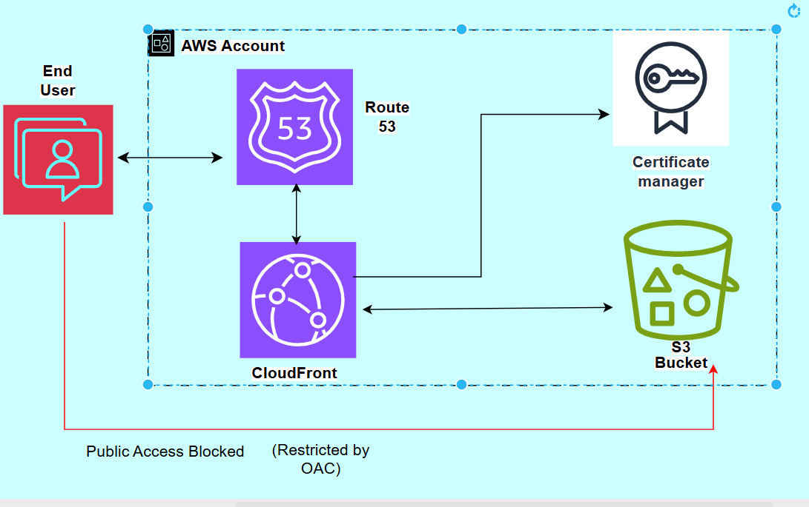

# AWS Secure Static Website Hosting with S3, CloudFront, Route 53 & ACM

## Project Overview

This project demonstrates the deployment of a static website on AWS using Amazon S3, Amazon CloudFront, Amazon Route 53, and AWS Certificate Manager (ACM).

The focus was on secure hosting, HTTPS delivery, custom-domain configuration, and restricting access to the S3 origin through CloudFront Origin Access Control (OAC).

The website frontend was sourced from TemplateMo. This project focuses on the AWS infrastructure, deployment, and security configuration.

## Architecture

The diagram below illustrates the AWS services used in this project and how they work together.

## AWS Services Used

- **Amazon S3:** Stores the static website files.
- **Amazon CloudFront:** Delivers website content to users.
- **CloudFront Origin Access Control (OAC):** Allows CloudFront to access the private S3 origin.
- **Amazon Route 53:** Manages DNS records for the custom domain.
- **AWS Certificate Manager (ACM):** Provides the TLS certificate used for HTTPS.

## Security Considerations

- S3 Block Public Access is configured to restrict public access.
- CloudFront OAC is used to secure access to the S3 origin.
- HTTPS is configured for secure website delivery.
- AWS credentials and other secrets must not be committed to GitHub.

## Project Evidence

Screenshots documenting the deployment and AWS configuration are available in the `screenshots/` directory.

## Website Template Attribution

The website frontend was sourced from TemplateMo. The primary focus of this project was the AWS infrastructure, secure deployment, and configuration of the cloud services.

## Skills Demonstrated

- Amazon S3 configuration
- Amazon CloudFront distribution setup
- CloudFront Origin Access Control
- Amazon Route 53 DNS configuration
- AWS Certificate Manager
- HTTPS and TLS configuration
- Static website deployment
- Cloud security principles
- Technical documentation

## Lessons Learned

This project provided hands-on experience configuring AWS services to deliver a static website through a custom domain while applying cloud security principles.

It also reinforced the importance of restricting direct access to storage origins and verifying DNS and HTTPS configurations.